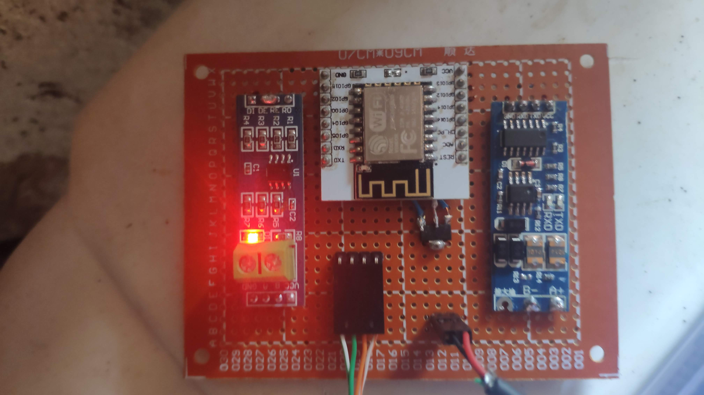

# Sofar rs485 logger

## Description:
SofarSolar inverters can be monitored by using solarman cloud by default, however I wanted to log all the inverter data in home assistant with a complete integration. This can be accomplish by reading the rs485 registers from the inverter as described in SofarSolar documentation. 
Also my on-grid inverter can't track the power that is purchased from the grid. In order to solve this problem I added an external chint ddsu666 metter. 
By using rs485 I can read the power from the metter and by doing this I can compute the exported and purchased energy from the grid to send this data to home assistant. 

## Features:
* Integration with home assistant
* Logs all the inverter info that can be accesed by the rs485 registers
* By using the chint ddsu666 external metter, can compute and send the exported/purchased energy from the grid

## Parts:
* Waveshare ESP32-S3-Relay-1CH (the ESP8266 version is in the git history, before 2.0.0)
* 1x RS485 to TTL converter with automatic direction control, for the second bus

## Wiring:
| Bus | Port | Pins |
|---|---|---|
| Inverter | Onboard isolated RS485 (terminal block A/B) | GPIO17 TX, GPIO18 RX, GPIO21 direction |
| DDSU666 meter | External converter on connector J5 | IO1 → DI/TXD of the converter, IO2 ← RO/RXD, 3V3, GND |

The buses can be swapped with `INVERTER_ON_ONBOARD_PORT` in `src/config.h`.

## Setup:
1. Copy `src/secrets.example.h` to `src/secrets.h` and set the password of the configuration access point.
2. Upload with PlatformIO (`pio run -t upload`). The first upload must be done over USB.
3. On the first start the device opens the WiFi access point `SOFAR-LOGGER`. Connect to it and open http://192.168.4.1:
   * **Configure WiFi**: choose the network and its password.
   * **Setup**: MQTT broker, port, user, password, TLS and, only for a self-signed broker certificate, its CA in PEM.
4. The device restarts with the new settings.

To change the settings later, open the portal again by holding the BOOT button for 3 seconds or with the
"Abrir portal de configuración" button in Home Assistant. It closes itself after 10 minutes, and the meters keep
being read while it is open.

The entities are created in Home Assistant by MQTT discovery ([HomeAssistantEntities](https://github.com/Johboh/HomeAssistantEntities)), there is nothing to configure in YAML.

## Prototype:

